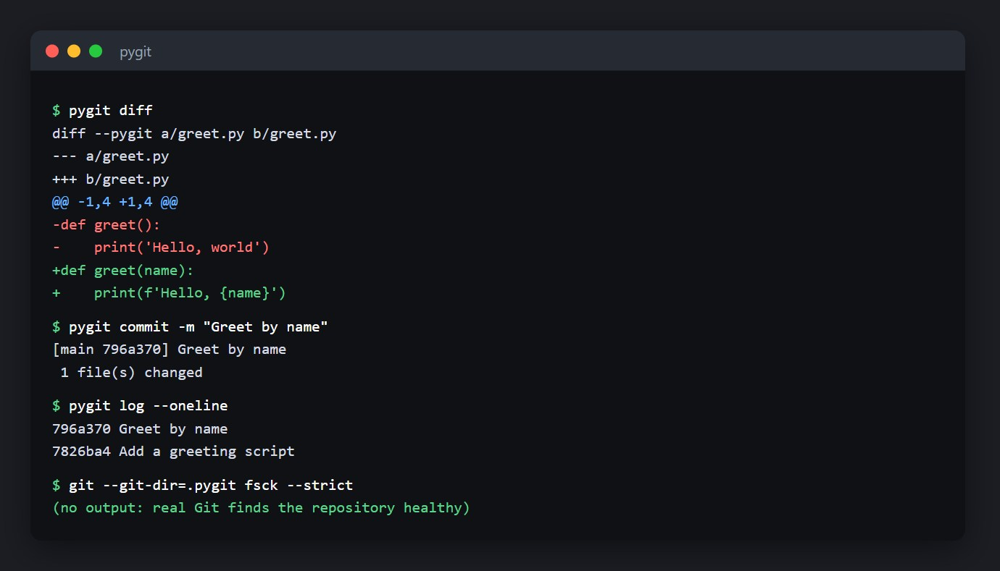

# pygit ZO: Git, rebuilt in Python


pygit ZO is a small implementation of Git in Python (about 1,100 lines with comments), with no dependencies. You run it with the command `pygit`. It stores data in **Git's real object format**, so the two tools understand each other: a repository made by pygit passes `git fsck --strict`, and pygit can read the commits real Git wrote.



## What it does

| Command | What it does |
| --- | --- |
| `pygit init` | Create a repository in `.pygit/` |
| `pygit config user.name "Ada"` | Read or set your identity |
| `pygit add <paths>` | Stage files or whole folders (deletions too) |
| `pygit status` | Show staged, modified, and untracked files |
| `pygit diff [--staged]` | Unified diff of the working folder or the staged changes |
| `pygit commit -m "message"` | Record the staged changes |
| `pygit log [--oneline] [-n N] [rev]` | Show history, newest first |
| `pygit branch [-d] [name] [start]` | List, create, or delete branches |
| `pygit checkout [-b] <branch or commit>` | Switch branches, or detach HEAD at a commit |
| `pygit hash-object [-w] <file>` | Compute (and store) an object id |
| `pygit cat-file -p/-t/-s <object>` | Show an object's content, type, or size |
| `pygit ls-files`, `pygit ls-tree [-r] [rev]` | List the index, or the files of a commit |

Revisions can be `HEAD`, a branch name, a full or abbreviated SHA-1 (at least 4 hex digits), or `<rev>~N` (for example `HEAD~2`). Run `pygit --version` to see the version.

A `.pygitignore` file keeps untracked files out of `add` and `status`: one wildcard pattern per line (`*.log`, `build/`, `/top-level-only`), with `#` for comments. There is no negation (`!pattern`), and `*` also matches across `/`. A file that is already tracked stays tracked even if a pattern later matches it.

## Try it

You need Python 3.10 or newer (developed and tested on 3.14).

```bash
git clone https://github.com/Gothrick/pygit-ZO.git
cd pygit-ZO
pip install -e .
```

Then, in any empty folder:

```bash
pygit init
pygit config user.name "Ada Lovelace"
pygit config user.email ada@example.com

echo "print('hello')" > hello.py
pygit add hello.py
pygit commit -m "First commit"
pygit log
```

Without installing, `python -m pygit <command>` works from the cloned folder.

Settings can also come from environment variables: `PYGIT_AUTHOR_NAME` and `PYGIT_AUTHOR_EMAIL` override the stored identity. `PYGIT_DATE="1700000000 +0100"` fixes the commit time (the tests use it; years after 3000 and impossible time zones are refused), and `PYGIT_DEBUG=1` shows full Python tracebacks for unexpected errors.

### Check it against real Git

```bash
git --git-dir=.pygit log --oneline      # real Git reads your history
git --git-dir=.pygit fsck --strict      # and checks every object
```

The full session behind the screenshot is in [docs/screenshots/full-session.jpg](docs/screenshots/full-session.jpg).

## How it is built

```text
pygit/
  objects.py      Blobs, trees, commits: hashing, compression, and the exact byte formats
  repository.py   The .pygit folder: HEAD, branches, revisions, config, ignore rules
  index.py        The staging area
  commands.py     Every command, as a function that returns the text to print
  diff.py         Unified diffs
  cli.py          Argument parsing
tests/            195 tests, including checks against the real git program
```

[HOW_IT_WORKS.md](HOW_IT_WORKS.md) explains the ideas behind each part: how a file becomes a blob, how a commit is built from the index, what a branch really is, and how checkout works.

## Tests

```bash
pip install -e ".[dev]"
pytest
ruff check .
```

The suite covers the object formats, every command, and **interoperability**: real `git fsck --strict`, `git log`, and `git ls-tree` run on pygit repositories, and pygit reads objects written by real Git. It also covers the cases where a version control tool must not lose or corrupt data: checkout never overwrites untracked or ignored files, repository folders cannot be added, branch names and identities are validated, and problems are reported as one-line errors (some tests run `pygit` as a separate process with piped output, so Unicode file names and error handling are tested the way a shell uses them). The interop tests are skipped if `git` is not installed, and one test about the executable bit is skipped on Windows.

## How it differs from real Git

pygit is a learning project, not a replacement for Git.

- The repository folder is `.pygit`, and the **index** is a JSON file (`.pygit/index.json`). Git's index is a binary format; everything else (objects, refs, HEAD) is Git's real format.
- Only **loose objects** are supported, not pack files. References packed by `git gc` can be read, but a missing object gets an explanatory error.
- No merge, rebase, tags, stash, or remotes. History is followed through all parents, but pygit never creates merge commits.
- `checkout` refuses to run when tracked files have staged or unstaged changes, or when it would overwrite an untracked or ignored file, instead of trying to carry changes over. It checks for conflicts before touching any file, so a refusal changes nothing, and it warns when you leave a detached commit that no branch can reach.
- Files inside `.pygit` or any `.git` folder are never added. Symbolic links are skipped.
- Branch names follow Git's rules plus the names Windows cannot store (`aux`, `con`, `a|b`). A name made only of 4 to 40 hex digits (`cafe`, `2024`, `abcd1234`) is refused, because it could not be told apart from a commit id, and names that differ only by letter case (`dev` and `Dev`) cannot coexist, because Windows and macOS would store them as one file.
- pygit records the executable bit where the operating system has one (covered by a test that is skipped on Windows). On Windows every file is a regular file, and a mode change alone is not detected by `status`.
- `diff` prints a `diff --pygit` header, has no rename detection, and shows no mode lines.
- Speed is fine for small projects but not tuned: adding thousands of files takes several seconds, depending mostly on the disk.

## Background

This follows the "build your own Git" idea from the [build-your-own-x](https://github.com/codecrafters-io/build-your-own-x) collection. The design comes from Git's documented internals (see the "Git Internals" chapter of [Pro Git](https://git-scm.com/book/en/v2/Git-Internals-Git-Objects)).

## License

[MIT](LICENSE)
